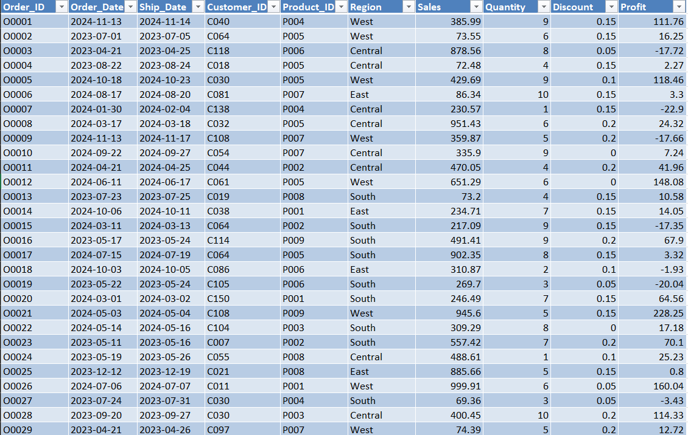

# Tableau-Project
Data Visualization Projects using Tableau
## Project Preview

## Project Overview
This project is an interactive Sales Performance Dashboard developed using Tableau for Global Retail Pvt Ltd. It analyzes sales, profit, discounts, products, customers, and regional performance. Users can explore Sales Overview and Product & Customer Insights dashboards to identify business trends, compare performance, and gain meaningful insights through interactive visualizations.
## From Data to Dashboard
The project started with a structured dataset, followed by data preparation, analysis, dashboard planning, and final visualization in Tableau.
### Source Data

## Dashboard Features
- Interactive Filters for Region, Category, and Date
- Dynamic KPI Cards for Total Sales, Profit, and Quantity
- Monthly Sales and Profit Trend Analysis
- Product and Customer Performance Comparison
- Regional Sales Analysis with Interactive Visualizations
## Files Included

| File | Description |
|---|---|
| Dashboard-image.png | Preview of the final dashboard |
| data.png | Preview of the source data |
| README.md | Project documentation |

[Download the Excel dataset](tableau_project_dataset.xlsx)
