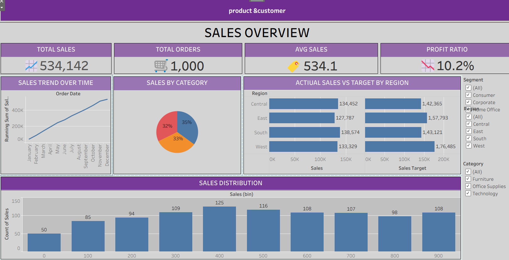
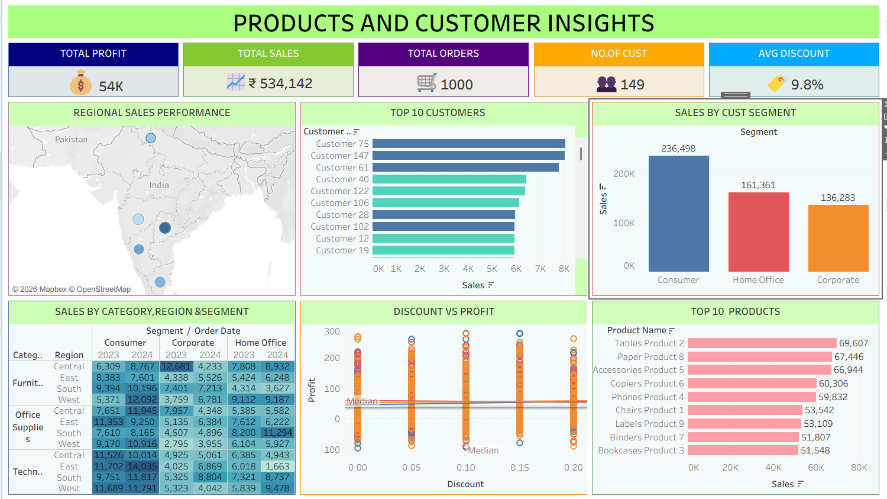

# Tableau-Project
Data Visualization Projects using Tableau
## Project Preview

## Project Overview
This project is an interactive Sales Performance Dashboard developed using Tableau for Global Retail Pvt Ltd. It analyzes sales, profit, discounts, products, customers, and regional performance. Users can explore Sales Overview and Product & Customer Insights dashboards to identify business trends, compare performance, and gain meaningful insights through interactive visualizations.
